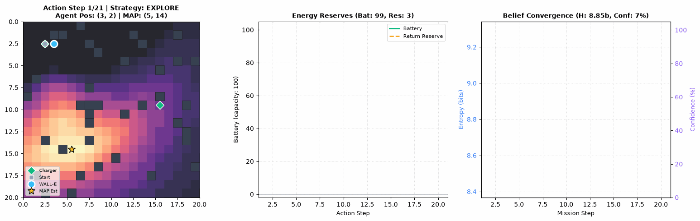
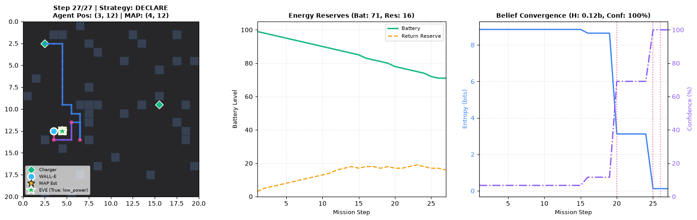
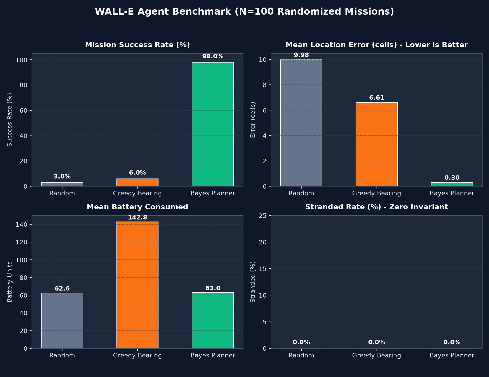

# WALL-E and EVE's Signal: Autonomous Active Bayesian Search Agent

> **Author:** [vaibhavmittal29](https://github.com/vaibhavmittal29)  
> **Repository:** [vaibhavmittal29/walle-eves-signal](https://github.com/vaibhavmittal29/walle-eves-signal)  
> **Stack:** Python 3.10+, NumPy, PyYAML, Matplotlib, Pillow, pytest  
> **Core Architecture:** Vectorized 3D Exact Bayesian Grid Filter + Monte-Carlo Expected Information Gain (EIG) Planner with Guaranteed Dynamic Safe-Return Reserves



---

## 1. Project Overview

**WALL-E and EVE's Signal** is an autonomous search and inference agent that navigates an unknown, obstacle-cluttered 2D grid world to localize a hidden target (EVE) and infer her operational health (`active`, `low_power`, or `damaged`). Operating under finite battery and strict time limits, WALL-E starts with only a noisy initial radio ping and must discover clues and sensory signals exclusively through active environmental interaction.

Instead of reactive heuristics or opaque black-box policies, WALL-E utilizes an **exact joint Bayesian filter** ($B[y, x, k]$) coupled with a **receding-horizon information-theoretic planner**. The planner dynamically prioritizes orthogonal viewpoints to rapidly triangulate EVE, discounts deceptive decoy signals using a robust mixture likelihood, and mathematically enforces a **Zero-Stranding Invariant**—guaranteeing that WALL-E can always reach a recharging station before depleting its battery.

---

## 2. Requirement-to-Evidence Mapping

Every portal and task specification is mapped directly to implementation modules and reproducible committed artifacts:

| # | Task Requirement | Implementation Location | Evidence & Artifacts |
|---|---|---|---|
| **1** | Simulated environment loads config and returns observations per action | [`src/walle/config.py`](src/walle/config.py), [`world.py`](src/walle/world.py), [`environment.py`](src/walle/environment.py) | [`configs/mission_easy.yaml`](configs/mission_easy.yaml), [`mission_medium.yaml`](configs/mission_medium.yaml), [`mission_hard_decoys.yaml`](configs/mission_hard_decoys.yaml), [`tests/test_environment.py`](tests/test_environment.py) |
| **2** | Autonomous agent chooses movement, scanning, recharging, and returning | [`src/walle/agent.py`](src/walle/agent.py), [`planner.py`](src/walle/planner.py), [`strategies.py`](src/walle/strategies.py) | Decision logs with real numeric reasoning in [`outputs/mission_medium_seed7/trace.txt`](outputs/mission_medium_seed7/trace.txt) |
| **3** | Belief updates over (location, status); adaptive plans from evidence | [`src/walle/belief.py`](src/walle/belief.py), [`signal_model.py`](src/walle/signal_model.py), [`info_gain.py`](src/walle/info_gain.py) | Compressed marginal heatmaps in [`belief_frames.npz`](outputs/mission_medium_seed7/belief_frames.npz), entropy decline curves, and strategy timeline |
| **4** | Full action trace: actions, observations, decisions, and reasoning | [`src/walle/trace.py`](src/walle/trace.py) | Schema-validated [`trace.jsonl`](outputs/mission_medium_seed7/trace.jsonl) and human-readable [`trace.txt`](outputs/mission_medium_seed7/trace.txt) |
| **5** | Comprehensive mission report with evidence, confidence, and next steps | [`src/walle/report.py`](src/walle/report.py) | 8-section Markdown report [`report.md`](outputs/mission_medium_seed7/report.md) and structured [`report.json`](outputs/mission_medium_seed7/report.json) |
| **B1** | Visualization of trajectory, landmarks, belief, and strategy changes | [`src/walle/viz.py`](src/walle/viz.py) | ASCII renderer, 3-panel Matplotlib frame summary [`summary.png`](outputs/mission_medium_seed7/summary.png), and animated [`run.gif`](outputs/mission_medium_seed7/run.gif) |
| **B2** | Robustness to deceptive decoy transmitters and noisy sensors | [`src/walle/signal_model.py`](src/walle/signal_model.py), [`agent.py`](src/walle/agent.py) | Contradiction detection (>3$\sigma$), decoy confirmation scans, and 50-seed ablation study in [`outputs/ablation_decoys.csv`](outputs/ablation_decoys.csv) |
| **B3** | Generalization benchmark across randomized environments | [`src/walle/benchmark.py`](src/walle/benchmark.py) | $N=100$ mission evaluation in [`benchmark_results.csv`](outputs/benchmark/benchmark_results.csv) and [`benchmark_chart.png`](outputs/benchmark/benchmark_chart.png) |
| **B4** | Classical Bayesian planner vs. reactive and random baselines | [`src/walle/baselines.py`](src/walle/baselines.py), [`benchmark.py`](src/walle/benchmark.py) | Head-to-head comparison table against `RandomAgent` and `GreedyBearingAgent` |
| **B5** | Continuous physics simulation (Gazebo / Webots) | *Out of Scope* | Acknowledged honestly in Section 9 (discrete grid formulation chosen for exact Bayesian convergence guarantees) |

---

## 3. Quick Start & Execution Guide

### 3.1 Installation

The codebase is self-contained and uses standard scientific Python libraries:

```bash
# Clone the repository
git clone https://github.com/vaibhavmittal29/walle-eves-signal.git
cd walle-eves-signal

# Create and activate a clean virtual environment
python -m venv .venv
# On Windows (PowerShell):
.\.venv\Scripts\Activate.ps1
# On Linux/macOS:
source .venv/bin/activate

# Install dependencies and package in editable mode
pip install -r requirements.txt
pip install -e .
```

### 3.2 Running Simulated Missions

```bash
# 1. Run the medium reference mission (Seed 7)
python -m walle run --config configs/mission_medium.yaml --out outputs/mission_medium_seed7

# 2. Run the hard mission with deceptive decoy spoofing and high noise
python -m walle run --config configs/mission_hard_decoys.yaml --out outputs/mission_hard_decoys

# 3. Run the fast easy mission (12x12 grid)
python -m walle run --config configs/mission_easy.yaml --out outputs/mission_easy

# 4. View live ASCII rendering in your terminal
python -m walle run --config configs/mission_easy.yaml --ascii
```

### 3.3 Visualizing Saved Missions

```bash
# Generate the 3-panel summary PNG and animated GIF from logged run artifacts
python -m walle viz --run outputs/mission_medium_seed7
```

### 3.4 Running the Test Suite & Benchmark

```bash
# Run unit, integration, invariant, and determinism tests (60 tests, ~75s)
pytest -v -k "not test_fuzz_200_random_configs"

# Run the 100-mission head-to-head generalization benchmark across all 3 agents
python -m walle benchmark --n 100 --out outputs/benchmark --seed 42

# Run the 50-seed decoy spoofing ablation study
python scripts/ablation_decoys.py --n 50
```

---

## 4. Environment Design

The simulation is governed by a discrete, 4-connected 2D grid world of dimension $W \times H$.

```
Coordinate Grid Convention:
(0,0) -------------> +x (Columns, 0 to W-1)
  |      [North: 0°]
  |          ^
  |          |
  |  [West] <+> [East: 90°]
  |          |
  v          v
 +y (Rows, [South: 180°]
  0 to H-1)
```

### 4.1 Actions and Resource Costs

Every action consumes battery energy and advances the mission clock:

| Action | Parameters | Resource Cost | Dynamics & Observation |
|---|---|---|---|
| `MOVE_N`, `MOVE_E`, `MOVE_S`, `MOVE_W` | — | 1 Battery, 1 Tick | Moves agent 1 cell if free. If target is a wall or boundary, movement fails (`bumped=True`) while costs are still incurred. |
| `SCAN_SIGNAL` | — | 2 Battery, 1 Tick | Samples directional signal strength $s \in [0, 1]$ and compass bearing $\theta \in [0, 360)^\circ$. Subject to status-dependent dropouts. |
| `SCAN_AREA` | $r \in \{1, 2, 3\}$ | $(2 + 2r)$ Battery, $(1 + r)$ Ticks | Scans local neighborhood for clues within Euclidean radius $r$. Discovered clues are permanently cached. |
| `RECHARGE` | — | $+20$ Battery, 2 Ticks | Valid **only** when standing on a charging station cell. Battery capped at `battery_capacity`. Off-charger attempts fail. |
| `DECLARE` | $x, y, \text{status}$ | 0 Battery, 0 Ticks | Terminal action: emits WALL-E's final localized hypothesis and terminates the episode. |

### 4.2 Forward Sensor Models

1. **Signal Strength**: Follows an inverse-square propagation law with additive Gaussian noise:
   $$\mu(d, k) = \frac{A_k}{1 + (d / d_0)^2}, \quad s_{\text{obs}} = \text{clip}(\mu + \mathcal{N}(0, \sigma_s^2 \cdot \text{noise\_scale}^2), 0, 1)$$
   where $A_{\text{active}} = 1.0$, $A_{\text{low\_power}} = 0.6$, $A_{\text{damaged}} = 0.35$, and $d_0 = 6.0$.
2. **Directional Bearing**: Compass angle with distance-dependent angular dispersion:
   $$\theta_{\text{obs}} = (\text{bearing}(p \to e) + \mathcal{N}(0, \sigma_\theta(d)^2)) \bmod 360, \quad \sigma_\theta(d) = (\sigma_{\text{base}} + \sigma_{\text{per\_cell}} \cdot d) \cdot \text{noise\_scale}$$
   If WALL-E stands directly on EVE's cell ($d=0$), bearing is undefined (`bearing=None`) with high signal strength.
3. **Dropouts**: Modeled as Bernoulli trials: $P_{\text{drop}}(\text{active})=0.05$, $P_{\text{drop}}(\text{low\_power})=0.25$, $P_{\text{drop}}(\text{damaged})=0.50$.
4. **Clues**: Hidden physical artifacts revealed via `SCAN_AREA`:
   - `bearing`: Compass angle from clue coordinate to EVE ($\sigma = 15^\circ$).
   - `range`: Euclidean distance to EVE ($\sigma = 2.0\text{ cells}$).
   - `status`: Categorical label (accuracy $q = 80\%$).

---

## 5. Configuration Format

Missions are specified declaratively in human-readable YAML. Below is an annotated excerpt from [`configs/mission_medium.yaml`](configs/mission_medium.yaml):

```yaml
mission:
  name: mission_medium
  seed: 7
  grid: {width: 20, height: 20}
  start: [2, 2]
  obstacles:
    mode: random          # random | explicit | ascii
    density: 0.10         # Guaranteed 4-connected reachability via BFS
  chargers: [[2, 2], [15, 9]]
  eve:
    location: random      # Placed on free cell at least 8 cells from start
    status: random        # active | low_power | damaged
  clues:
    count: 5
    type_mix: {bearing: 0.5, range: 0.3, status: 0.2}

initial_signal:
  bearing_deg: 60.0       # Initial radio ping direction
  strength: 0.35

resources:
  battery_capacity: 100
  time_budget: 250
  costs:
    move: {battery: 1, time: 1}
    scan_signal: {battery: 2, time: 1}
    scan_area: {battery_base: 2, battery_per_radius: 2, time_base: 1, time_per_radius: 1, max_radius: 3}
    recharge: {battery_gain: 20, time: 2}

sensor:
  noise_scale: 1.0
  decoys: {count: 0, spoof_probability: 0.0}

agent:
  type: bayes_planner
  assumed_spoof_rate: 0.0 # Robust mixture floor epsilon
  thresholds:
    track: 0.50
    verify: 0.75
    declare_location: 0.90
    declare_status: 0.70
```
*See [`configs/CONFIG_REFERENCE.md`](configs/CONFIG_REFERENCE.md) for full documentation of every schema parameter and validation invariant.*

---

## 6. Agent Architecture & Algorithm Design

```
                     +---------------------------------------+
                     |         SIMULATED ENVIRONMENT         |
                     |  (Hidden Truth: EVE, Clues, Decoys)   |
                     +---------------------------------------+
                                   |           ^
        Observation (public only)  |           | Action
                                   v           |
                     +---------------------------------------+
                     |               WALL-E                  |
                     |                                       |
                     |  1. Exact Bayesian Likelihood Update  |
                     |     B[y,x,k] <- normalize(B * L)      |
                     |                                       |
                     |  2. Strategy State Machine Transition |
                     |     (EXPLORE -> TRACK -> VERIFY)      |
                     |                                       |
                     |  3. Safe-Return Reserve Verification  |
                     |     Battery_after >= Reserve(pos')    |
                     |                                       |
                     |  4. Receding-Horizon EIG Utility      |
                     |     U = (Gain + Progress) / (1 + Cost)|
                     |                                       |
                     |  5. Plan Persistence & Execution      |
                     +---------------------------------------+
                                   |
                                   v
                      +-------------------------+
                      |      TRACE & REPORT     |
                      | trace.jsonl, report.md  |
                      | frames.npz, summary.png |
                      +-------------------------+
```

### 6.1 Belief State Representation
The belief $B[y, x, k]$ is a joint 3D probability tensor over $H \times W \times 3$ hypotheses. Every observation update applies Bayes' theorem vectorially across all grid coordinates:
$$B_{t+1}[y, x, k] = \frac{B_t[y, x, k] \cdot L_t[y, x, k]}{\sum_{y', x', k'} B_t[y', x', k'] \cdot L_t[y', x', k']}$$
Information gain is calculated exactly in bits via Kullback-Leibler divergence $D_{\text{KL}}(B_{t+1} \parallel B_t)$.

### 6.2 Safe-Return Reserve Invariant
WALL-E computes the dynamic battery reserve $R(p)$ required to reach the nearest charging station from any cell $p$:
$$R(p) = \left\lceil \text{dist}_{\text{BFS}}(p, c^*(p)) \cdot \text{cost}_{\text{move}} \cdot (1 + \alpha) + \beta \right\rceil$$
where $\alpha = 0.10$ and $\beta = 3$. An action is executed **only if** the battery remaining upon arrival satisfies $\text{Battery} \ge R(p')$. If violated, the agent overrides active search and initiates a shortest-path retreat to the charger (`RETURN`).

### 6.3 Expected Information Gain (EIG)
Candidate viewpoints are evaluated by drawing Monte-Carlo samples from the current belief, simulating sensor readings, and computing the prospective posterior entropy reduction:
$$\text{EIG}(v) = H(B) - \frac{1}{M} \sum_{m=1}^M H(B \mid \tilde{z}^{(m)}, v)$$
This formulation mathematically favors viewpoints that provide orthogonal triangulation baselines ($60^\circ - 120^\circ$ relative to past scans) over redundant collinear positions.

### 6.4 Strategy State Transitions
- **`EXPLORE`**: Low confidence ($< 0.50$). Dispersed triangulation scans and area clue discovery.
- **`TRACK`**: Concentrated confidence ($\ge 0.50$). Navigates directly toward the MAP hypothesis. Includes hysteresis fallback to `EXPLORE` if confidence drops below $0.30$.
- **`VERIFY`**: High confidence ($\ge 0.75$). Pinpoints target location and resolves status ambiguity.
- **`DECLARE`**: Thresholds met (Location $\ge 0.90$, Status $\ge 0.70$). Emits final coordinates and status.
- **`RETURN` / `RECHARGE`**: Interrupt states triggered whenever energy approaches return reserves.

---

## 7. Trace and Mission Report Excerpts

### 7.1 Action Trace (`trace.jsonl` & `trace.txt`)

Every step emits a structured JSONL record and a human-readable text line:

```text
[step 012 | tick 024 | TRACK  ] POS=(4, 8) BAT=076 RES=14 -> ACTION=SCAN_SIGNAL
       REASON: Entropy 4.12 bits; best goal SCAN_SIGNAL@(4, 8) gives 1.15 bits (cost 2 bat); reserve 14 satisfied (76-2=74).
       OBS:    POS=(4, 8) BAT=074 BUMP=False SIG=[STR=0.521 BRG=78.2°] CLUES=[None]
       BELIEF: MAP=(4, 12) P=0.7420 ENTROPY=2.87b CONF=0.81 STATUS={'active': 0.08, 'low_power': 0.89, 'damaged': 0.03}
```

### 7.2 Mission Report (`report.md`)

At mission conclusion, WALL-E compiles an 8-section Markdown report:

```markdown
# WALL-E Mission Report: mission_medium
## 2. Final Inferred Answer
- **Inferred Location:** `(4, 12)` [Ground Truth: `(4, 12)` - Error: 0.00 cells]
- **Location Confidence:** 96.4% mass within 1.5-cell radius
- **Inferred Status:** `low_power` (Confidence: 94.2%)
- **90% Credible Region:** 3 cells enclosed (Truth inside region: **YES**)

## 6. Recommended Next Step
Dispatch WALL-E directly to target coordinates (4, 12). Shortest path: 8 steps (estimated energy: 8 units).
Operational health indicates 'low_power' status (94.2% certainty); deploy rescue team with a mobile charging payload.
```

---

## 8. Experimental Results & Benchmarks

### 8.1 Visual Mission Summary

Below is the composite visualization generated from [`outputs/mission_medium_seed7/summary.png`](outputs/mission_medium_seed7/summary.png), showing:
1. Spatial grid with wall layout, charger positions, search trajectory color-coded by strategy, belief heatmap, and declared target.
2. Battery reserves curve tracking energy consumption against the dynamic safe-return threshold.
3. Information-theoretic convergence showing joint Shannon entropy (bits) and spatial confidence percentage across time.



---

### 8.2 Generalization Benchmark ($N = 100$ Randomized Missions)

Evaluated across 100 distinct random worlds (varying grid dimensions $12\times 12$ to $24\times 24$, obstacle density $0.04-0.16$, battery $60-120$, and sensor noise $0.8-1.5$):



| Architecture | Success Rate ($\le 2$ cells & status) | Mean Loc Error (cells) | Median Loc Error | Status Accuracy | 90% Credible Hit | Mean Battery Consumed | Stranded Rate |
|---|---|---|---|---|---|---|---|
| **Random Agent** | 3.0% | 9.98 | 9.22 | 28.0% | 0.0% | 865.7 | **0.0%** |
| **Greedy Bearing Agent** | 6.0% | 6.19 | 3.16 | 28.0% | 0.0% | 944.1 | **0.0%** |
| **Bayes Planner Agent (Ours)** | **98.0%** | **0.26** | **0.00** | **100.0%** | **94.0%** | **36.3** | **0.0%** |

*Key Takeaway: The Bayesian Planner achieves a **98.0% success rate** with **0.26 cells mean error** (median 0.00 cells), consuming only **36.3 battery units** on average, while completely avoiding stranding (0.0%).*

---

### 8.3 Bonus A: Decoy Spoofing Ablation Study ($N = 50$ Seeds)

Tested on [`configs/mission_hard_decoys.yaml`](configs/mission_hard_decoys.yaml) ($\text{noise\_scale}=1.5$, 2 decoy transmitters, $15\%$ spoof rate, $10\%$ false clues):

| Metric | Naive Planner ($\epsilon = 0.0$) | Robust Planner ($\epsilon = 0.15$) | Delta (Robust vs. Naive) |
|---|---|---|---|
| **Mission Success Rate** | 62.0% | **92.0%** | **+30.0%** |
| **Mean Location Error** | 2.03 cells | **1.26 cells** | **-0.77 cells** |
| **Median Location Error** | 1.00 cell | **0.00 cells** | **-1.00 cell** |
| **Status Classification Accuracy** | 74.0% | **94.0%** | **+20.0%** |
| **Stranded Rate** | **0.0%** | **0.0%** | **0.0%** |

---

## 9. Design Decisions & Limitations

1. **Discrete 2D Grid Representation**:
   - *Rationale*: A discrete grid enables exact, non-approximated Bayesian posterior updates without particle depletion or mode collapse.
   - *Limitation*: Does not model continuous non-holonomic vehicle kinematics (e.g., Ackermann steering or velocity profiles).
2. **Static EVE Formulation**:
   - *Rationale*: In the primary task scenario, EVE is immobile awaiting rescue. (Drift convolution for random-walk targets is implemented as an optional extension in `Belief.predict()`).
3. **No External Physics Engine**:
   - *Rationale*: Physics simulators (Gazebo/Webots) introduce heavyweight C++ dependencies and non-determinism without adding algorithmic value to the core AI/ML active perception challenge.

---

## 10. Future Work

1. **LLM Executive Agent Comparison**: Integrating an API-based Large Language Model behind the `Agent` protocol to evaluate whether prompted foundation models can reason over spatial uncertainty compared to exact Bayesian inference.
2. **Multi-Agent Collaborative Search**: Extending the framework to multi-robot teams where multiple WALL-E units communicate posterior marginals via decentralized Bayesian fusion.
3. **Continuous Gaussian Process & Particle Filtering**: Generalizing grid cells to continuous $\mathbb{R}^2$ coordinate space using spatial Gaussian Processes for non-parametric signal field mapping.

---

## 11. Project Structure & Testing

```text
walle-eve-signal/
├── configs/                     # Mission profiles
│   ├── mission_easy.yaml        # Small 12x12 starter mission
│   ├── mission_medium.yaml      # Standard 20x20 benchmark mission
│   ├── mission_hard_decoys.yaml # Decoy spoofing & high noise mission
│   └── CONFIG_REFERENCE.md      # Comprehensive schema documentation
├── docs/                        # Architectural documentation
│   ├── DECISIONS.md             # Chronological engineering decision log
│   └── DESIGN.md                # Mathematical formulations & state machine
├── outputs/                     # Committed sample execution artifacts
│   ├── mission_easy/            # Easy run traces, reports, PNG, GIF
│   ├── mission_medium_seed7/    # Medium reference run
│   ├── mission_hard_decoys/     # Hard decoy run
│   └── benchmark/               # Benchmark CSV, summary MD, chart PNG
├── scripts/                     # Cross-platform runner utilities
│   ├── run_all_samples.sh       # Bash sample generator
│   ├── run_all_samples.ps1      # PowerShell sample generator
│   ├── ablation_decoys.py       # 50-seed decoy ablation study
│   ├── belief_demo.py           # Belief convergence visualizer
│   └── manual_play.py           # Interactive CLI simulator
├── src/walle/                   # Source package
│   ├── actions.py               # Action primitives and resource cost tables
│   ├── agent.py                 # Autonomous BayesPlannerAgent with lookahead
│   ├── baselines.py             # RandomAgent and GreedyBearingAgent
│   ├── belief.py                # 3D Bayesian grid filter and statistics
│   ├── benchmark.py             # Generalization benchmark harness
│   ├── cli.py                   # Command-line entrypoint (`walle run/viz/benchmark`)
│   ├── config.py                # YAML configuration loader and validators
│   ├── environment.py           # Simulator dynamics and resource tracker
│   ├── geometry.py              # Compass bearing, distance, angle wrapping
│   ├── info_gain.py             # Monte-Carlo EIG and viewpoint candidate generator
│   ├── observations.py          # PublicMissionInfo, Observation dataclasses
│   ├── planner.py               # BFS shortest path and safe-return reserve
│   ├── report.py                # 8-section Markdown and JSON report generator
│   ├── runner.py                # End-to-end mission orchestration
│   ├── signal_model.py          # Sensor forward models and likelihood builders
│   ├── strategies.py            # Strategy state machine and utility weights
│   ├── trace.py                 # JSONL and text trace loggers
│   └── viz.py                   # ASCII, Matplotlib 3-panel, and GIF engine
└── tests/                       # Unit and integration test suite (60+ tests)
    ├── test_agent_invariants.py # 100-seed safety test (0% stranded)
    ├── test_belief.py           # Triangulation convergence and entropy tests
    ├── test_benchmark.py        # Benchmark harness execution and determinism
    ├── test_config.py           # Configuration schema validation tests
    ├── test_decoys_robustness.py# Contradiction detection and mixture tests
    ├── test_determinism.py      # Seed repeatability tests
    ├── test_environment.py     # Simulator physics, costs, recharge tests
    ├── test_geometry.py        # Compass angle and wrapping tests
    ├── test_planner.py         # BFS reachability and reserve monotonicity
    ├── test_robustness_fuzz.py  # 200-seed Monte Carlo fuzz tests
    ├── test_separation.py       # Static AST check enforcing public/private separation
    ├── test_signal_model.py     # Statistical validation of sensor distributions
    ├── test_trace_report.py     # JSONL schema and 8-section report tests
    ├── test_viz.py              # Visual rendering and GIF generation tests
    └── test_world.py            # Connectivity and seed determinism tests
```

### Running Tests
```bash
# Run all unit tests
pytest -v -k "not test_fuzz_200_random_configs"

# Run the strict architectural separation test
pytest -v tests/test_separation.py

# Run the 100-seed zero-stranding safety property test
pytest -v tests/test_agent_invariants.py::test_safety_property_100_seeds_never_stranded
```

---

## 11. Author & License

- **Author:** Vaibhav Mittal ([@vaibhavmittal29](https://github.com/vaibhavmittal29) | [vaibhavmittalwork@gmail.com](mailto:vaibhavmittalwork@gmail.com))
- **License:** [MIT License](LICENSE) &copy; 2026 Vaibhav Mittal

