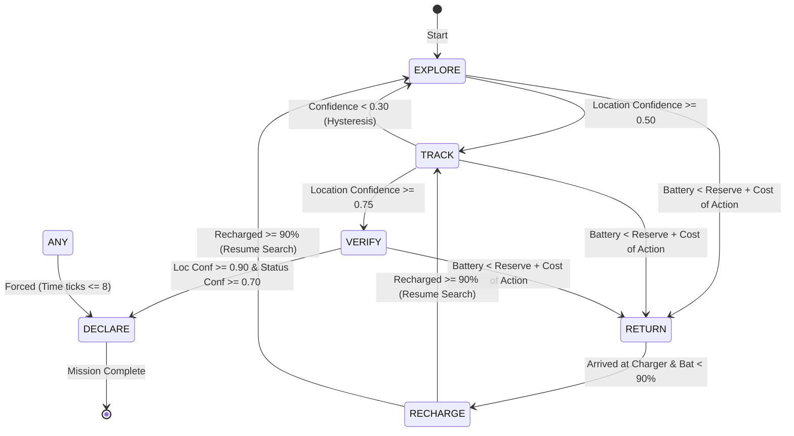

# WALL-E and EVE's Signal: System Architecture & Design Document

> **Project:** Autonomous Search Agent for Vinnovate IT (AI/ML Task 2)  
> **Builder:** First-year CSE student  
> **Core Stack:** Python 3.10+, NumPy, PyYAML, Matplotlib, Pillow, pytest  

---

## 1. Executive Summary & Problem Formulation

WALL-E is tasked with localizing a hidden target (EVE) and inferring her operational status within a discrete 2D grid world. The environment features impassable obstacles (walls), recharging stations, and hidden clues revealed through exploratory active sensing.

WALL-E must achieve this mission under strict operational constraints:
1. **Limited Resources**: Finite battery capacity and global mission time tick budget.
2. **Safe-Return Invariant**: The agent must **never get stranded** in the field without power; it must always retain enough battery to reach a charging station.
3. **Noisy & Deceptive Sensing**: Signal strength decays non-linearly with distance, bearings are corrupted by distance-dependent Gaussian noise, dropouts occur stochastically based on operational health, and decoy beacons may broadcast spoofed signals.
4. **Information-Theoretic Decision Making**: WALL-E chooses actions using active Bayesian perception, maximizing Expected Information Gain (EIG) per unit resource cost.

---

## 2. Mathematical Formulations

### 2.1 Belief State Representation

The agent represents its state of knowledge as a joint 3D probability tensor:
$$B[y, x, k] = P(\text{Location} = (x, y), \text{Status} = k \mid z_{1:t})$$
where:
- $(x, y) \in \{0, \dots, W-1\} \times \{0, \dots, H-1\}$ are 4-connected grid coordinates (with $y$ pointing downward and $x$ pointing rightward).
- $k \in \{\text{active}, \text{low\_power}, \text{damaged}\}$ denotes EVE's true operational health.
- $\sum_{y=0}^{H-1} \sum_{x=0}^{W-1} \sum_{k=0}^2 B[y, x, k] = 1.0$.
- $B[y, x, :] = 0$ for all wall/obstacle cells $(x, y) \in \text{Walls}$.

#### Marginals, MAP, and Shannon Entropy
- **Spatial Location Marginal**:
  $$P(x, y) = \sum_{k} B[y, x, k]$$
- **Operational Status Marginal**:
  $$P(k) = \sum_{x, y} B[y, x, k]$$
- **Maximum A Posteriori (MAP) Estimate**:
  $$(x_{\text{map}}, y_{\text{map}}) = \arg\max_{(x, y)} P(x, y)$$
- **Joint Shannon Entropy (in bits)**:
  $$H(B) = -\sum_{y, x, k} B[y, x, k] \log_2 (B[y, x, k] + 10^{-15})$$
- **Information Gain (Kullback-Leibler Divergence)**:
  $$D_{\text{KL}}(B_{\text{new}} \parallel B_{\text{old}}) = \sum_{y, x, k} B_{\text{new}}[y, x, k] \log_2 \left( \frac{B_{\text{new}}[y, x, k] + 10^{-15}}{B_{\text{old}}[y, x, k] + 10^{-15}} \right)$$

---

### 2.2 Forward Sensor Models & Likelihood Builders

When an observation $z$ is collected from position $p_{\text{agent}} = (x_a, y_a)$, the likelihood tensor $L[y, x, k] = P(z \mid \text{hyp}=(x, y, k), p_{\text{agent}})$ is computed vectorially over all grid cells.

#### Signal Strength Likelihood
Expected signal amplitude decays with Euclidean distance $d = \|(x, y) - (x_a, y_a)\|_2$:
$$\mu(d, k) = \frac{A_k}{1 + (d / d_0)^2}$$
where $A_{\text{active}} = 1.0$, $A_{\text{low\_power}} = 0.6$, $A_{\text{damaged}} = 0.35$, and $d_0 = 6.0$.  
Given observed strength $s_{\text{obs}}$ and noise standard deviation $\sigma_s = \sigma_{s,0} \cdot \text{noise\_scale}$:
$$L_{\text{strength}}(s_{\text{obs}} \mid x, y, k) = \frac{1}{\sqrt{2\pi}\sigma_s} \exp\left( -\frac{(s_{\text{obs}} - \mu(d, k))^2}{2\sigma_s^2} \right)$$

#### Directional Compass Bearing Likelihood
Bearings follow standard navigational compass conventions ($0^\circ = \text{North } (-y)$, $90^\circ = \text{East } (+x)$, $180^\circ = \text{South } (+y)$, $270^\circ = \text{West } (-x)$):
$$\theta(p_{\text{agent}} \to (x, y)) = \left(\text{atan2}(x - x_a, -(y - y_a)) \cdot \frac{180}{\pi}\right) \bmod 360$$
Angular error dispersion increases linearly with distance:
$$\sigma_\theta(d) = (\sigma_{\text{base}} + \sigma_{\text{per\_cell}} \cdot d) \cdot \text{noise\_scale}$$
Given measured bearing $\theta_{\text{obs}}$, the wrapped angular error is $\Delta\theta = ((\theta_{\text{obs}} - \theta + 180) \bmod 360) - 180$:
$$L_{\text{bearing}}(\theta_{\text{obs}} \mid x, y, k) = \frac{1}{\sqrt{2\pi}\sigma_\theta(d)} \exp\left( -\frac{\Delta\theta^2}{2\sigma_\theta(d)^2} \right)$$
*Zero-Distance Invariant*: At $d = 0$, compass bearing is physically undefined; hence $L_{\text{bearing}} = 0.0$ at the agent's exact cell when a bearing is reported.

#### Dropout Likelihood
Stochastic dropouts occur with Bernoulli probability $P_{\text{drop}}[k]$ ($P_{\text{active}}=0.05, P_{\text{low\_power}}=0.25, P_{\text{damaged}}=0.50$):
$$L(z_{\text{drop}} \mid k) = P_{\text{drop}}[k], \quad L(z_{\text{reading}} \mid k) = (1 - P_{\text{drop}}[k])$$

#### Robust Mixture Likelihood for Decoys / Spoofing
When spoofing rate $\epsilon > 0$:
$$L_{\text{robust}}[y, x, k] = (1 - \epsilon) L_{\text{sensor}}[y, x, k] + \epsilon \cdot \frac{1}{|FreeCells| \times 3}$$
This guarantees a uniform probability floor, preventing anomalous decoy readings from collapsing the posterior on the true target cell.

#### Decoy Contradiction Detection Rule
Signals arriving with angular divergence exceeding a $3\sigma$ confidence bound and at least $45^\circ$ from the MAP hypothesis:
$$\text{Contradiction}(\theta_{\text{obs}}, \hat{\theta}) \iff |\Delta\theta| > \max(3.0 \cdot \sigma_\theta(d_{\text{MAP}}), 45.0^\circ)$$
When detected and $\epsilon > 0$, the reading is flagged as suspicious, attenuated via mixture likelihood, and a confirmation scan from an orthogonal baseline is scheduled before declaration. When $\epsilon = 0.0$ (naive mode), contradiction handling and delayed declarations are deactivated.

---

### 2.3 Safe-Return Invariant & Dynamic Battery Reserves

The most critical project requirement is that **WALL-E must never get stranded away from a charging station**.

Let:
- $C = \{c_1, c_2, \dots, c_m\}$ be the set of reachable charging stations.
- $D(p, c)$ be the 4-connected shortest-path distance (computed via BFS) from cell $p$ to charger $c$.
- $c^*(p) = \arg\min_{c \in C} D(p, c)$ be the nearest charger.
- $k_{\text{move}}$ be the battery cost per movement step (default 1 unit).
- $\alpha = 0.10$ (safety margin fraction) and $\beta = 3$ (flat reserve margin units), configurable per mission.

The **Dynamic Return Reserve** $R(p)$ is defined as:
$$R(p) = \left\lceil D(p, c^*(p)) \cdot k_{\text{move}} \cdot (1 + \alpha) + \beta \right\rceil$$

#### Safety Invariant
An action $a \in \mathcal{A}$ from position $p$ yielding resulting position $p'$ and costing $k_{\text{battery}}(a)$ is deemed **safe** if and only if:
$$\text{Battery}_{\text{current}} - k_{\text{battery}}(a) \ge R(p')$$
If an informative multi-step navigation plan to a candidate viewpoint $v$ is evaluated, safety is checked along the entire path:
$$\text{Battery}_{\text{current}} - \text{Cost}(p \to v \to \text{scan}) \ge R(v)$$
If no informative action satisfies the safety invariant, WALL-E immediately triggers the `RETURN` interrupt strategy, navigating back to $c^*(p)$ and initiating `RECHARGE`.

---

### 2.4 Active Perception: Expected Information Gain (EIG)

Rather than random walk or reactive heading pursuit, WALL-E plans by predicting the expected reduction in Shannon entropy:
$$\text{EIG}(p) = H(B) - \mathbb{E}_{z \sim P(z \mid p, B)} \left[ H(B \mid z, p) \right]$$

Since the measurement space is continuous and multimodal, we approximate $\text{EIG}(p)$ via **Monte-Carlo sampling**:
1. Sample $M = 30$ target hypotheses $(x^{(m)}, y^{(m)}, k^{(m)}) \sim B[y, x, k]$.
2. For each sample $m$, simulate a synthetic reading $\tilde{z}^{(m)}$ using the forward sensor model.
3. Compute the prospective posterior belief $B^{(m)} \propto B \cdot L(\tilde{z}^{(m)} \mid p)$.
4. Compute the expected posterior entropy: $\bar{H} = \frac{1}{M} \sum_{m=1}^M H(B^{(m)})$.
5. $\text{EIG}_{\text{signal}}(p) = \max(0.0, H(B) - \bar{H})$ bits.

#### Area Scan Information Gain Proxy
For clue detection via `SCAN_AREA(r)` across discrete radii $r \in \{1, 2, 3\}$:
$$\text{EIG}_{\text{area}}(p, r) = \max(0, N_{\text{expected\_clues}} - N_{\text{found}}) \cdot \frac{|\text{UnscannedFreeCells}(p, r)|}{|\text{TotalUnscannedFreeCells}|} \cdot G_{\text{clue}}$$
where $G_{\text{clue}} = 1.0\text{ bit}$. Each radius $r \in \{1, 2, 3\}$ is evaluated as a separate candidate action with resource costs $\text{Cost}_{\text{battery}} = 2 + 2r$ and $\text{Cost}_{\text{time}} = 1 + r$.

---

### 2.5 Multi-Objective Utility Function & Plan Persistence

Given candidate goals $g$ (e.g., scan at current position, scan area, or navigate to viewpoint $v$ and scan):
$$U(g) = \frac{\text{Gain}(g) + \text{Progress}(g)}{1.0 + w_{\text{cost}} \cdot \text{Cost}_{\text{norm}}(g)}$$
where:
- $\text{Gain}(g) = w_{\text{info}} \cdot \text{EIG}_{\text{signal}} + w_{\text{clue}} \cdot \text{EIG}_{\text{area}}$.
- $\text{Progress}(g) = w_{\text{prog}} \cdot \max(0, D(p, \mu_B) - D(v, \mu_B))$ encourages forward traversal toward the belief centroid $\mu_B$.
- $\text{Cost}_{\text{norm}}(g) = \frac{\text{BatteryCost}(g)}{\text{BatteryCapacity}} + \frac{\text{TimeTicks}(g)}{\text{TimeBudget}}$.

#### Plan Persistence and 15% Re-planning Rule
Once a multi-step navigation plan is established, the agent commits to its execution unless:
1. The next scheduled action violates the safe-return invariant.
2. The high-level strategy state machine triggers a transition (e.g., `EXPLORE` $\to$ `TRACK`).
3. A fresh observation (signal reading or physical clue) arrives, updating posterior entropy.
4. A newly evaluated candidate goal exceeds the utility of the active plan by more than $15\%$ ($U(g^*) > 1.15 \cdot U(\text{current})$).

#### Strategy-Adaptive Weights

| Strategy State | $w_{\text{info}}$ | $w_{\text{clue}}$ | $w_{\text{prog}}$ | $w_{\text{cost}}$ | Objective Focus |
|---|---|---|---|---|---|
| **EXPLORE** | 1.0 | 0.6 | 0.1 | 1.5 | Broad triangulation & clue discovery |
| **TRACK** | 0.7 | 0.2 | 0.5 | 1.5 | Direct closing on concentrated MAP hypothesis |
| **VERIFY** | 1.0 | 0.0 | 0.3 | 1.0 | High-confidence target confirmation |
| **RETURN** | — | — | — | — | Deterministic shortest path to charger |
| **RECHARGE** | — | — | — | — | Dwell on charger until $\ge 90\%$ capacity |

---

## 3. High-Level Strategy State Machine

---

## 4. Why Bayesian Planning Over RL or LLMs?

1. **Guaranteed Safety**: The safe-return invariant can be mathematically checked and guaranteed at every tick. Deep RL and LLMs cannot offer zero-stranding guarantees.
2. **Data Efficiency & Zero Training**: Operates out of the box with zero training episodes or pre-collected datasets.
3. **Exact Interpretability**: Every belief update is an exact application of Bayes' theorem. Shannon entropy in bits provides an unforgeable, calibrated measure of uncertainty.
4. **Computational Determinism**: Identical random seeds produce byte-for-byte identical action traces.
